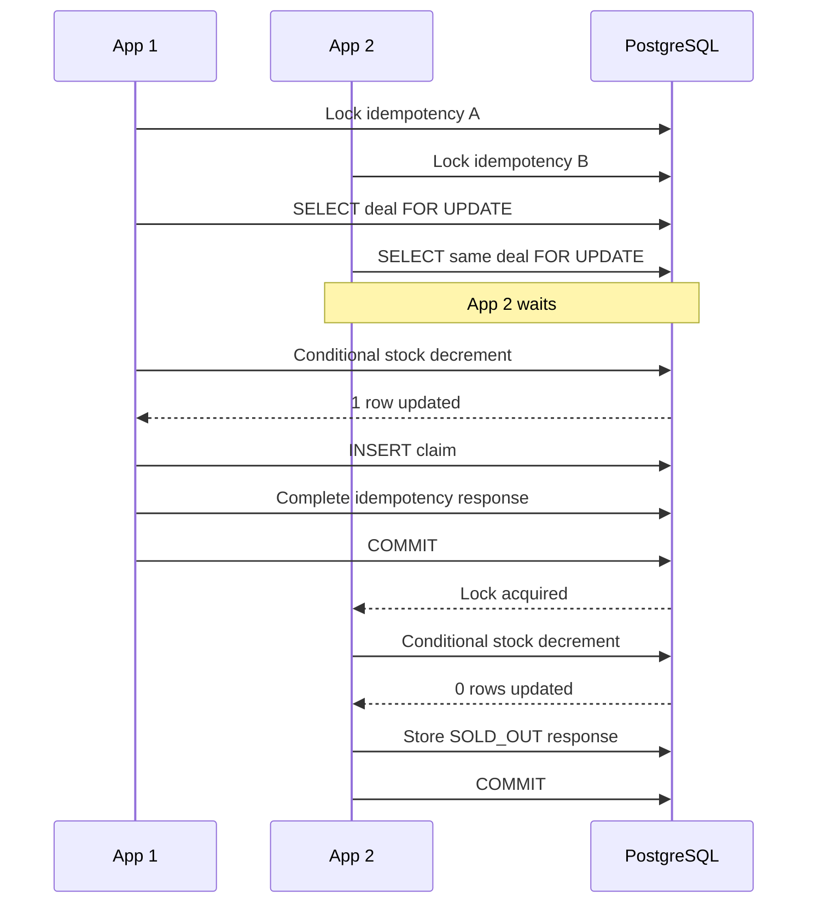
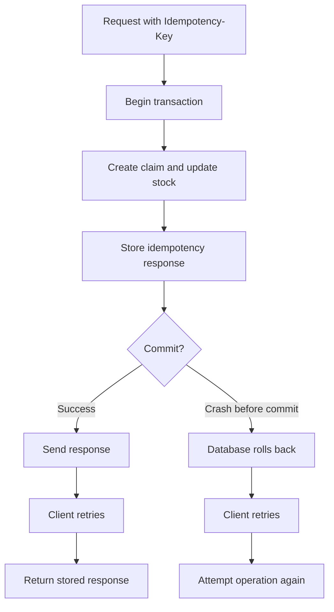
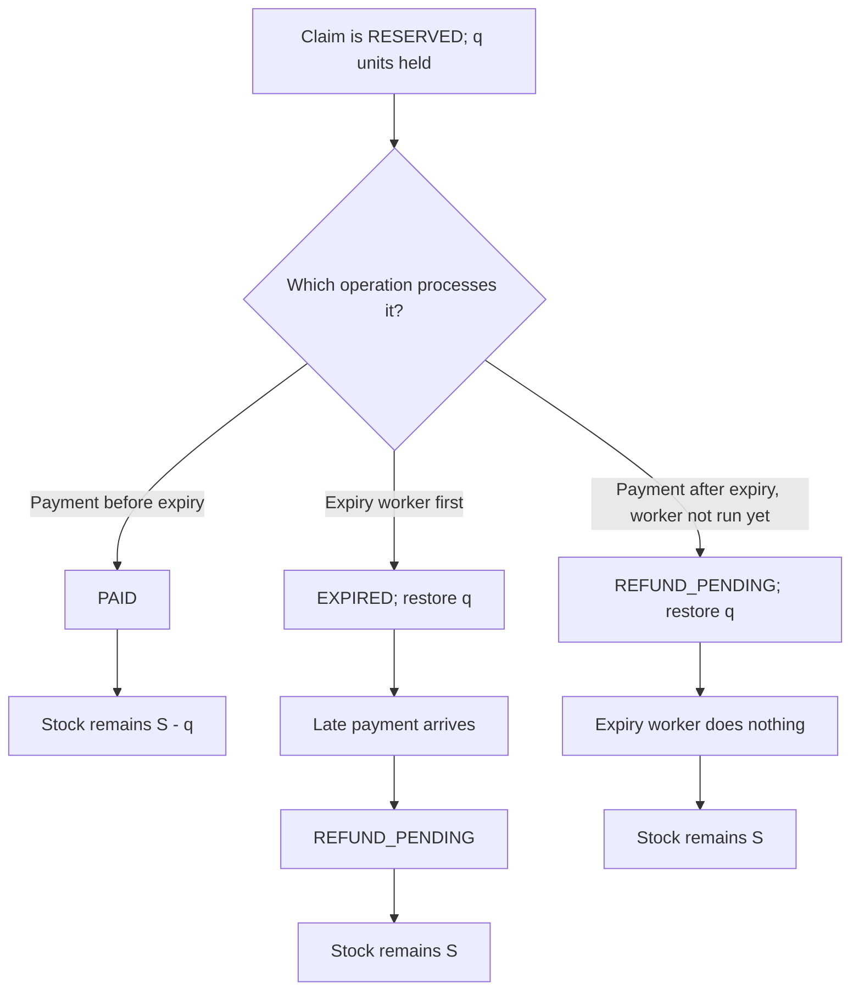

# Design Decisions

## 1. Two customers on different instances claim the last unit at the same instant. Walk through the SQL each request runs and what PostgreSQL does with it. Why wouldn't a Kotlin Mutex or synchronized block fix this?

Both application instances connect to the same PostgreSQL database, so I use database transactions and row-level locking to protect stock.

For each claim, my implementation follows this sequence:

1. Begin a database transaction.
2. Lock and verify the idempotency record.
3. Lock the deal row using `SELECT ... FOR UPDATE`.
4. Process expired reservations.
5. Check whether the deal is live.
6. Check for an existing active claim.
7. Decrease stock using a conditional SQL update.
8. Insert the claim and complete the idempotency response.
9. Commit the transaction.

Suppose only one unit is available. Both instances can lock their own idempotency records, but only one can acquire the deal row lock first. The second transaction waits.

The first transaction successfully decreases stock and inserts its claim. After it commits, the second transaction acquires the deal lock. Its conditional stock update affects zero rows because sufficient stock is no longer available. It stores a `SOLD_OUT` response and commits that result.

I would not use a Kotlin `Mutex` or `synchronized` block for this because they only coordinate threads inside one JVM. They cannot coordinate separate application instances. PostgreSQL provides the shared locking mechanism.

## 2. Your service commits a claim, then crashes before responding. The client retries with the same Idempotency-Key . What happens? What if it crashed just before the commit?

I use idempotency keys because a client may not know whether a request succeeded if the server crashes or the response is lost.

There are two cases:

- **Crash after commit but before response:** The claim, stock update and completed idempotency response are already saved. When the client retries with the same key and payload, the server returns the stored response instead of creating another claim.
- **Crash before commit:** PostgreSQL rolls back the uncommitted transaction. The claim and stock update are not partially saved. The client can retry using the same key, and the operation can be attempted again.

I store the claim and its completed idempotency result in the same transaction. This prevents a situation where the claim is committed but its corresponding idempotency result is missing.

If the same key is reused with a different payload, I return `422`. If the original request is still in progress, I return `409`.

The main idea is that retrying a request should not accidentally create a second purchase.

## 3. A payment.succeeded webhook and your expiry job reach the same claim in the same millisecond. List every possible ordering, with the final claim status and stock for each.

Both operations use database transactions and follow the same locking order: first the deal row, then the claim row. This prevents them from independently changing the same claim at the same time.

After acquiring the locks, the payment handler checks the database clock against the claim's `expires_at`.

There are three important cases, assuming the payment amount is correct:

**Case 1: Payment handler gets the locks first, before expiry.**

The payment is accepted and the claim becomes `PAID`. When the expiry worker runs later, it finds that the claim is no longer `RESERVED`, so it does not expire the claim or restore stock.

- Final status: `PAID`
- Stock: Units remain deducted.

**Case 2: Expiry worker gets the locks first.**

The worker changes the claim to `EXPIRED` and restores its quantity. When the payment webhook arrives, it sees the expired claim and changes its status to `REFUND_PENDING`. It does not restore stock again.

- Final status: `REFUND_PENDING`
- Stock: Units have already been returned.

**Case 3: Payment handler gets the locks first, but the reservation has already expired.**

Even if the expiry worker has not processed the claim yet, the payment handler checks the database time and detects that the reservation has expired. It changes the status to `REFUND_PENDING` and restores stock itself. The expiry worker later finds that the claim is no longer `RESERVED` and does nothing.

- Final status: `REFUND_PENDING`
- Stock: Units are returned exactly once.

The important invariant is that stock must be restored only once. `REFUND_PENDING` means that a refund is required because payment arrived after the reservation expired. It does not mean that an actual refund has already been issued through a payment provider.

A failed payment does not immediately change the reservation. It remains subject to normal expiry.

## 4. Why must the webhook signature cover the raw body rather than the parsed JSON? What does the timestamp protect against, and why compare signatures in constant time?

I verify payment webhooks using HMAC-SHA256 and a shared webhook secret.

The signature is calculated using the timestamp followed by a dot and the exact raw request body.

I use the raw body because parsing JSON and converting it back into a string can change its representation. For example, whitespace, property order or formatting may differ even if the JSON represents the same data. These changes can produce a different signature.

The timestamp helps prevent replay attacks. I accept requests only when the timestamp is within 300 seconds of the current time. This limits the time window in which an intercepted signed request can be reused.

I use `MessageDigest.isEqual()` for signature comparison. A normal comparison may reveal information through differences in execution time. Constant-time comparison reduces this timing-based information leak.

I also use a unique `event_id` in the database so duplicate webhook deliveries cannot apply the same payment event more than once.

## 5. Which transaction isolation level do you use, and why is it enough? Name an anomaly you'd see with a weaker approach.

I use PostgreSQL's default `READ COMMITTED` isolation level, along with explicit row-level locks and conditional updates.

I do not rely on simply reading the available stock and updating it later. For example, if one unit is available, two transactions could both read `stock_available = 1` and then both try to create a claim. This can lead to overselling in an unsafe read-then-write implementation.

I avoid this by locking the deal row with `FOR UPDATE`. The second transaction waits until the first commits. The conditional stock update then ensures that stock is decreased only when enough units are available.

Database constraints provide additional protection against invalid stock values and duplicate active claims.

I chose this approach because explicit locking protects the critical stock operation without requiring the higher overhead of `SERIALIZABLE` isolation for every transaction.

## 6. Which constraint or index does the most work in your design? What breaks if someone drops it?

The partial unique index on `(customer_id, deal_id)` for active claim statuses is one of the most important constraints in my design.

It prevents a customer from having more than one active claim for the same deal. The active statuses are:

- `RESERVED`
- `PAID`
- `NEEDS_REVIEW`

Application-level checks alone are not enough. Two concurrent requests could both check that no active claim exists and then both try to insert one. The unique index makes PostgreSQL enforce this rule.

If this index were removed, duplicate active claims could be created for the same customer and deal under concurrent requests.

The unique constraint on payment event IDs is also important because it prevents the same webhook event from being applied multiple times. The stock constraint and conditional stock update provide further protection against negative stock.

## 7. A deal goes viral and claim traffic grows 100×. What fails first, and what would you change?

For a very popular deal, I expect contention on the deal row to become the first bottleneck.

Every claim for that deal needs to lock the same row before updating stock. This is necessary for correctness, but as traffic increases, more requests may spend time waiting for that lock.

I would first measure database lock wait times, transaction duration, connection pool usage and API latency instead of immediately adding more infrastructure.

Then I would consider:

1. Adding rate limits to protect the claim endpoint.
2. Keeping transactions short and avoiding unnecessary work while holding locks.
3. Scaling application instances horizontally for requests that do not compete for the same deal row.
4. Using caching or read replicas for read-heavy deal details.
5. If one deal consistently receives extreme traffic, evaluating a more advanced stock-allocation or reservation design without weakening the no-overselling guarantee.

I would not remove the row lock just to increase throughput. Accepting more requests is not useful if the system allows more units to be sold than actually exist.

My priority would be to measure the bottleneck and improve throughput while preserving the correctness of the claim flow.
