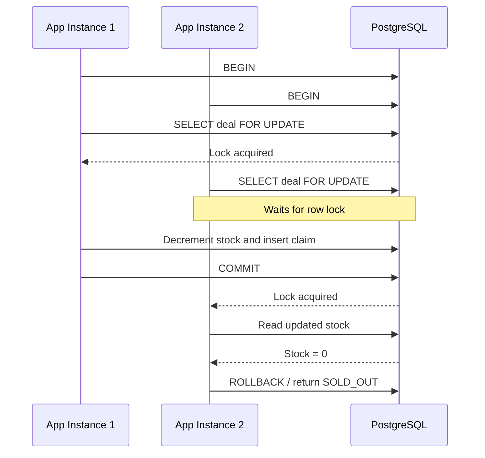
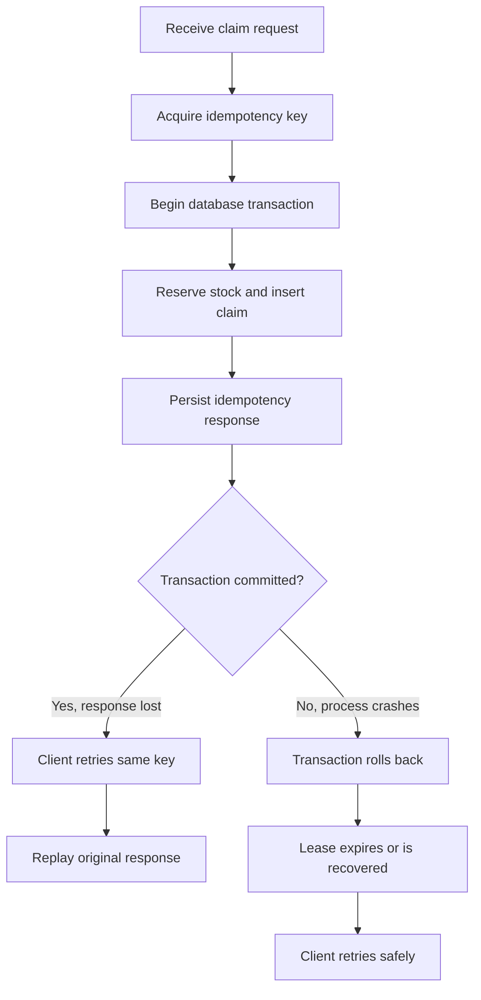
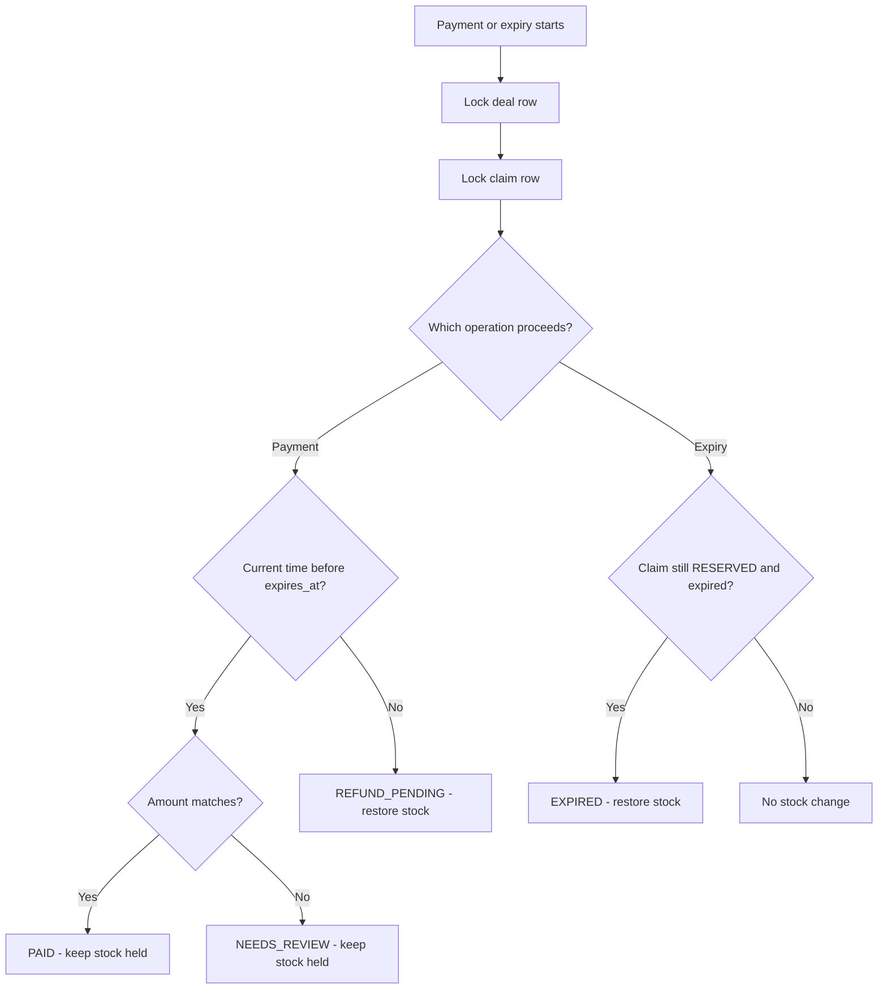

# Design Decisions — Nnomm Flash Deal Service

## 1. Preventing overselling across two application instances

Both application instances share the same PostgreSQL database. Correctness therefore depends on database-level coordination, not application-level synchronization.

When two customers attempt to claim the final unit simultaneously:

1. Each request begins a database transaction.
2. Each request attempts to lock the corresponding deal row using `SELECT ... FOR UPDATE`.
3. PostgreSQL grants the row lock to one transaction. The other transaction waits.
4. The first transaction checks that the deal is live, expires any eligible reservations, and atomically decrements stock.
5. It inserts the claim and commits.
6. The waiting transaction acquires the lock and sees the updated stock. Its claim fails with `SOLD_OUT`.

The stock update also uses a condition equivalent to `stock_available >= quantity`, providing an additional safeguard against negative inventory.

A Kotlin `Mutex` or `synchronized` block would only coordinate threads inside one JVM. It cannot coordinate separate application instances or protect against another process accessing the database. PostgreSQL row-level locking works across both instances.

**Relevant implementation:** `ClaimRepository.kt`, particularly the deal row lock and transactional stock update.

## 2. Crash after claim creation and idempotency

The idempotency record and claim creation are coordinated through PostgreSQL transactions.

**Crash after commit but before the HTTP response:**

- The claim and its idempotency result have already been committed.
- The client retries with the same customer, key, deal, and quantity.
- The service finds the completed idempotency record.
- It returns the original status and response body with `Idempotent-Replayed: true`.
- No second claim is created and stock is not decremented again.

**Crash before commit:**

- PostgreSQL rolls back the uncommitted transaction when the connection is lost.
- The claim and its associated transaction changes are not committed.
- The idempotency lease can be recovered after its configured expiry.
- A retry can safely execute the request again.

This prevents duplicate claims even when the application process fails between database commit and HTTP response delivery.

**Relevant implementation:** claim route and idempotency repository logic.

## 3. Payment and expiry racing on the same claim

Payment processing and the expiry worker use the same lock order: **deal first, then claim**. Both operations therefore serialize their changes to the same reservation.

The database clock is checked after acquiring the locks, so the payment decision uses the state and time observed while holding those locks.

There are two important outcomes:

| Ordering | Final status | Stock effect |
|---|---|---|
| Payment obtains the locks before expiry and succeeds before `expires_at` with the correct amount | `PAID` | Units remain held |
| Expiry obtains the locks first and expires the reservation | `EXPIRED`, subsequently `REFUND_PENDING` if a late success arrives | Units are restored exactly once |
| Payment obtains the locks after `expires_at`, before the expiry worker | `REFUND_PENDING` | Payment handler restores units |
| Payment succeeds before expiry but the amount differs | `NEEDS_REVIEW` | Units remain held |

The key distinction is that a payment processed after `expires_at` cannot transition a reservation to `PAID`.

If expiry runs first, it restores stock and changes the claim status to `EXPIRED`. A subsequent successful payment changes the status to `REFUND_PENDING` without restoring stock again. If payment runs first after expiry, it changes the status to `REFUND_PENDING` and restores stock itself. The row locks and status checks prevent both paths from restoring the same units.

**Relevant implementation:** `PaymentRepository.kt`, expiry processing in `ClaimRepository.kt`.

## 4. Webhook signature verification

The webhook signature is calculated over the timestamp followed by a period and the exact raw request body:

`timestamp.raw_request_body`

Using parsed JSON instead would be unsafe because JSON can have multiple equivalent representations. Differences in whitespace, key ordering, or serialization could change the bytes being verified.

The verifier therefore:

1. Reads the raw request body.
2. Parses the timestamp and signature from `X-Payment-Signature`.
3. Rejects timestamps more than 300 seconds from the server clock.
4. Computes HMAC-SHA256 using `WEBHOOK_SECRET`.
5. Compares the supplied and calculated signatures using `MessageDigest.isEqual`.
6. Only then allows the request body to be parsed and processed.

The timestamp limits the useful lifetime of a captured signed request and reduces replay opportunities. The `event_id` uniqueness constraint provides an additional protection against duplicate event processing.

Constant-time comparison reduces the risk of leaking information about the expected signature through comparison timing.

**Relevant implementation:** `WebhookSignatureVerifier.kt` and the payment webhook route.

## 5. Transaction isolation and database consistency

The implementation uses PostgreSQL's default `READ COMMITTED` transaction isolation level; no custom isolation level is configured.

This is sufficient for the critical claim and payment operations because the implementation explicitly locks the relevant rows using `SELECT ... FOR UPDATE`.

The deal row acts as the serialization point for inventory changes on that deal. Once a transaction acquires the lock, competing transactions must wait before making their own inventory decisions.

The design also uses:

- Atomic conditional stock updates.
- Unique database constraints for important identity and active-claim rules.
- Transactions that combine claim creation, stock changes, and idempotency outcomes.
- Transactions that combine payment event insertion and claim state changes.

A weaker approach would be to read stock without locking and then update it based on the earlier value. Two transactions could both observe one available unit and both decide that a claim can succeed. This is a classic lost-update or overselling race.

The explicit locking and conditional update avoid relying on an earlier, potentially stale stock read.

## 6. Most important database constraint

The unique constraint preventing more than one active claim per customer and deal is especially important:

`(customer_id, deal_id)` for active statuses `RESERVED`, `PAID`, and `NEEDS_REVIEW`.

This is implemented as a partial unique index so that expired or otherwise inactive claims do not prevent a customer from claiming the deal again.

If this constraint were removed, concurrent requests using different idempotency keys could create multiple active claims for the same customer and deal. Idempotency alone would not prevent this because the requests could have different keys.

Other important constraints include:

- The primary key or unique constraint on `payment_events.event_id`, preventing duplicate event processing.
- Stock checks that prevent negative available inventory.
- Foreign keys linking claims to deals.

These database constraints provide protection even when requests arrive through different application instances.

## 7. Scaling to 100× claim traffic

The first likely bottleneck is contention on the deal row. Every claim for a popular deal must coordinate through the same row lock to preserve inventory correctness. As traffic increases, requests may spend more time waiting for that lock, increasing latency and reducing throughput.

I would scale in stages:

1. **Measure first:** Add request latency, database connection pool, lock-wait, transaction-duration, and error metrics.
2. **Improve database efficiency:** Keep transactions short, optimize queries and indexes, and avoid unnecessary work while holding locks.
3. **Control incoming traffic:** Add distributed rate limiting and request throttling across instances.
4. **Scale application instances:** Add more stateless service instances while retaining PostgreSQL as the source of truth.
5. **Scale database capacity:** Monitor connection pressure and query performance; consider read replicas for read-heavy endpoints such as deal retrieval.
6. **Consider hot-deal partitioning:** If a single deal becomes a severe contention point, evaluate a carefully designed inventory allocation strategy that preserves the no-overselling invariant.

I would not replace database coordination with an in-memory lock or asynchronous stock updates. Those approaches could weaken correctness across instances. Any future optimization must preserve the inventory and claim invariants.

---

**Summary:** The design prioritizes correctness over throughput. PostgreSQL transactions, row-level locks, conditional stock updates, unique constraints, and idempotent event processing provide the foundation for safe operation across multiple application instances.
